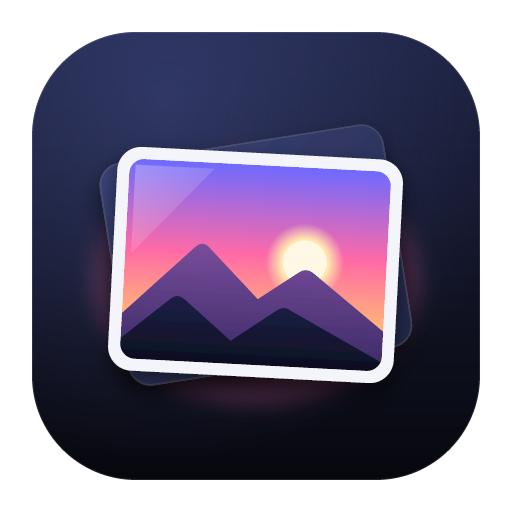
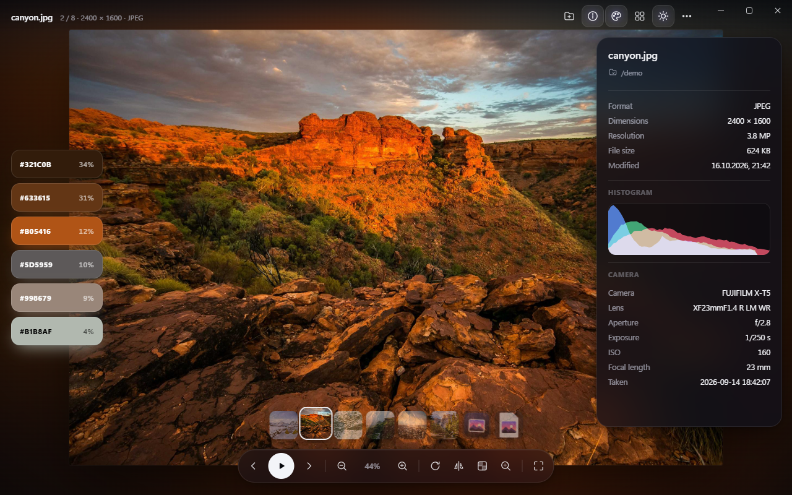

<p align="center">
  
</p>

<h1 align="center">Glint</h1>

<p align="center"><b>Every image. Instantly.</b><br/>A fast, beautiful image viewer for Windows and macOS.</p>

<p align="center">
  <a href="https://github.com/wl-lankin/glint/releases/latest"></a>
  
  <a href="LICENSE"></a>
</p>

<p align="center">
  
</p>

Glint opens any image the moment you double-click it, then gets out of the way. The picture fills the window, the controls float on glass and fade away when you stop moving the mouse, and every image sits in a soft glow of its own colors.

## Download

Get the latest version from the **[Releases page](https://github.com/wl-lankin/glint/releases/latest)**:

| Platform | File |
| --- | --- |
| Windows 10/11 (x64) | `Glint_<version>_x64-setup.exe` |
| macOS 11+ (Apple Silicon and Intel) | `Glint_<version>_universal.dmg` |

> The builds are not code-signed yet.
> **Windows:** SmartScreen may ask once: choose **More info > Run anyway**.
> **macOS:** open Glint with right-click > **Open** the first time, or run `xattr -cr /Applications/Glint.app`.

## Features

- **Every format.** PNG, APNG, JPEG, GIF, WebP, AVIF, SVG, BMP, ICO, TIFF, PSD, JPEG XL, TGA, QOI, DDS, Radiance HDR, OpenEXR, Netpbm and farbfeld on both systems, HEIC on macOS. Glint recognizes files by their content, so a PNG saved as `.jpg` still opens.
- **Your default viewer.** The installer registers Glint for every supported type. SVGs open in Glint instead of the browser.
- **Slideshow from a selection.** Select several images in Explorer or Finder and press Enter: Glint gathers them into one slideshow with gentle Ken Burns motion and a filmstrip. Open a single image and the arrow keys browse its folder.
- **Ambient light.** The window glows in the colors of the current image, like a TV with ambient lighting.
- **Contact sheet.** See the whole set as a grid and jump to any image.
- **Color palette.** The six dominant colors of the image, one click copies the hex code.
- **Pixel loupe.** Hold Alt (or press L) for a magnifier with a pixel grid and the color under the cursor.
- **Info and histogram.** Dimensions, file size, dates, an RGB histogram and camera data from EXIF.
- **Transparency done right.** Show transparent images on the ambient glow, a checkerboard, black or white.
- **English and German.** Glint follows your system language and can be switched under More > Language.
- **Always current.** Glint checks GitHub for new releases, downloads them in the background and installs them when you close it (or right away with "Restart to update"). Updates are signed; Glint accepts only builds from this repository.
- **Fast and light.** A native Rust core with the system WebView: a small download, a quick start, smooth zoom and pan.

## Make Glint your default

**Windows 11:** right-click an image > **Open with** > **Choose another app** > **Glint** > **Always**. Or open **Settings > Apps > Default apps > Glint** and pick it per file type.

**macOS:** select an image in Finder > **Get Info** (Cmd+I) > **Open with: Glint** > **Change All...**

## Keyboard shortcuts

| Key | Action |
| --- | --- |
| Left / Right | Previous / next image |
| Space | Play / pause the slideshow |
| G | Contact sheet |
| Mouse wheel | Zoom at the cursor |
| 0 / 1 | Fit to window / actual size |
| + / - | Zoom in / out |
| R / Shift+R | Rotate |
| F | Mirror |
| Enter / F11 | Fullscreen |
| I | Info and histogram |
| P | Color palette |
| L or hold Alt | Pixel loupe |
| A | Ambient light on / off |
| B | Backdrop for transparent images |
| Ctrl+C / Cmd+C | Copy the image |
| O / Ctrl+O | Open images |
| ? | All shortcuts |

## Auf Deutsch

Glint ist ein schneller, schöner Bildbetrachter für Windows und macOS. Er öffnet jedes gängige Bildformat (auch SVG, PSD, TIFF, JPEG XL, EXR und HEIC unter macOS), macht aus mehreren markierten Bildern automatisch eine Diashow, taucht jedes Bild in ein Umgebungslicht aus seinen eigenen Farben und bietet Kontaktabzug, Farbpalette, Pixellupe sowie Infos mit Histogramm und EXIF-Daten. Die Oberfläche folgt der Systemsprache (Deutsch oder Englisch), Updates installieren sich von selbst.

**Installation:** den passenden Download von der [Release-Seite](https://github.com/wl-lankin/glint/releases/latest) holen. **Als Standard festlegen** unter Windows 11: Rechtsklick auf ein Bild > **Öffnen mit** > **Andere App auswählen** > **Glint** > **Immer**. Unter macOS: Bild im Finder markieren > **Informationen** (Cmd+I) > **Öffnen mit: Glint** > **Alle ändern...**

## Build from source

You need [Node.js](https://nodejs.org) 22+ and [Rust](https://rustup.rs) (stable), plus the [Tauri prerequisites](https://tauri.app/start/prerequisites/) for your system.

```bash
npm install
npm run tauri dev      # run Glint with hot reload
npm run tauri build    # build the installer
npm test               # frontend tests
cd src-tauri && cargo test   # Rust tests
```

`npm run dev` alone starts the interface in a browser with demo images: put a few pictures in `demo/` and open `http://localhost:1420/?demo=show`.

Releases are built by GitHub Actions: bump the version in `package.json`, `src-tauri/Cargo.toml` and `src-tauri/tauri.conf.json`, add release notes in `docs/releases/v<version>.md` and push a tag `v<version>`. The workflow signs the update packages with the repository secrets `TAURI_SIGNING_PRIVATE_KEY` and `TAURI_SIGNING_PRIVATE_KEY_PASSWORD` and publishes `latest.json`, which installed copies of Glint pick up.

## How it works

Glint is a [Tauri 2](https://tauri.app) app. The Rust side serves images to the WebView through its own `glint://` protocol: formats the WebView draws itself pass through untouched, all others are decoded in Rust (`image`, `jxl-oxide`, `psd`) and handed over as PNG. Thumbnails for the filmstrip, the contact sheet and the ambient glow are made and cached in Rust too. When Explorer starts one Glint per selected file, the extra processes pass their files to the first one, which collects everything that arrives within a quarter of a second into one slideshow.

## Credits

Designed and built by **[Wolfgang Linz](https://wolfgang-linz.de)**.

Released under the [MIT License](LICENSE).
